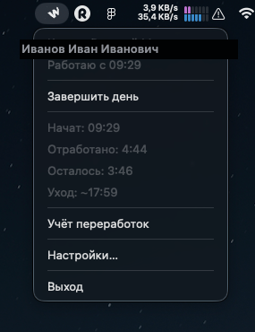
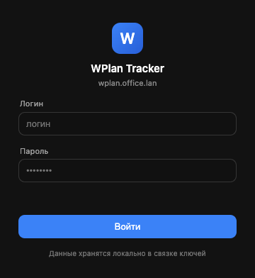
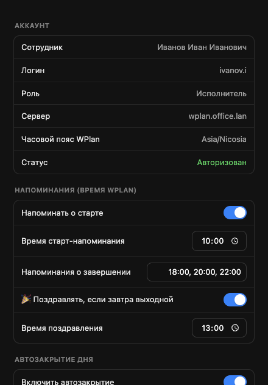

<div align="center">


# WPlan Tracker

**Нативное menu-bar приложение для macOS, которое ведёт твой рабочий день в WPlan за тебя.**

Старт и завершение дня в один клик из меню-бара, живая статистика, умные напоминания
и страховочное автозакрытие — чтобы день всегда засчитался.

</div>

---

## Зачем это

В корпоративном **WPlan** рабочий день нужно вручную начинать и завершать. Забыл завершить —
день не засчитывается. WPlan Tracker убирает эту рутину:

- кнопки **Начать / Завершить** прямо в меню-баре;
- всегда видно, **во сколько можно уходить** (с учётом переработок или без);
- напоминания о старте и завершении по расписанию;
- **автозакрытие дня** перед полуночью как страховка;
- приятный бонус — поздравление, если **завтра выходной** 🎉.

Приложение универсальное: подходит любому сотруднику, никаких персональных данных в коде —
логин и пароль каждый вводит сам (хранятся локально в Keychain).

## Скриншоты

### Меню в баре

Иконка-«W» в строке меню, по клику — меню со статусом, кнопкой и статистикой дня:



### Вход · Настройки · Автозакрытие

<p>

&nbsp;

&nbsp;

</p>

## Возможности

- **Старт/завершение дня** из меню-бара. Статус всегда синхронизируется со стейтом WPlan
  (источник правды — сервер, не локальный кэш).
- **Статистика текущего дня** как в WPlan: отработано, остаток, **расчётное время ухода**.
- **Учёт переработок** (тумблер): без переработок цель — полная дневная норма; с переработками —
  минимум, но с учётом доступного остатка переработок. Все нормы и остаток берутся из API.
- **Напоминания** (время WPlan): утром о старте, вечером о завершении (например 18:00 / 20:00 / 22:00).
- **Автозакрытие дня** ~23:55 с окном отмены — чтобы незакрытый день засчитался сегодня.
- **🎉 Поздравление**, если завтра выходной или праздник (в 13:00 по времени WPlan).
- **Нативные уведомления** macOS.
- **Автозапуск** при входе в систему (настраивается).
- **Безопасный вход**: логин/пароль хранятся в системной связке ключей (Keychain) через `safeStorage`.
- **Часовой пояс WPlan** определяется автоматически — всё считается в нём, а не в tz Mac.

## Установка

1. Скачайте `WPlan Tracker-x.y.z-arm64.dmg` из [Releases](../../releases).
2. Откройте `.dmg` и перетащите **WPlan Tracker** в `Applications`.
3. Приложение **неподписанное** (нет Apple Developer ID), поэтому при первом запуске:
   **правый клик по иконке → «Открыть»** (один раз), либо снять карантин:
   ```sh
   xattr -dr com.apple.quarantine "/Applications/WPlan Tracker.app"
   ```
4. Иконка появится в строке меню — нажмите «Войти» и введите свой логин/пароль WPlan.

> Текущие сборки — под **Apple Silicon (arm64)**. Сборка под Intel/universal добавляется
> одной строкой в конфиге (см. ниже).

## Настройки

Всё — в окне **Настройки…**:

- **Аккаунт** — ФИО, логин, роль, сервер, часовой пояс, статус авторизации; смена аккаунта.
- **Напоминания** — о старте, о завершении (список времён), поздравление о завтрашнем выходном.
- **Автозакрытие** — вкл/выкл, время, подтверждение и окно отмены, учёт переработок.
- **Система** — автозапуск при входе.
- **Системные параметры** (скрыты в аккордеоне) — хост WPlan, локаль, домен входа, период опроса.

## Сборка из исходников

Нужен **Node 18+** и доступ к хосту WPlan.

```sh
npm install
npm start          # собрать и запустить (dev)
npm run dist       # собрать .dmg (electron-builder)
npm run probe      # dev-проверка API: WPLAN_USERNAME=... WPLAN_PASSWORD=... npm run probe
```

Сборка под Intel/universal — добавить архитектуру в `package.json → build.mac`:

```jsonc
"mac": { "target": [{ "target": "dmg", "arch": ["arm64", "x64"] }] }
```

## Как это устроено

- **Electron + TypeScript**, UI — меню-бар (`Tray`) + несколько окон (вход, настройки, автозакрытие).
- **HTTP через Electron `net.fetch`** — использует сетевой стек Chromium, поэтому корпоративный
  CA берётся из системного keychain автоматически (без `NODE_EXTRA_CA_CERTS`).
- **GraphQL WPlan**: `startOrFinishDayButtonState` / `startOrFinishDay` (старт-стоп),
  `personalReport` (статистика, остаток, расчётное время ухода, переработки),
  `workerDaySummary.dayType` (рабочий/нерабочий день), `workerStartInfo` (tz, нормы), `jwtLogin` (вход).
- **Сессия**: cookie `connect.sid` персистится между запусками; у WPlan нет refresh-эндпоинта,
  поэтому при истечении сессии приложение **молча перелогинивается** учёткой из Keychain.
- **Поллинг с экспоненциальным бэкоффом** (до 30 мин) — чтобы не нагружать бэкенд при сбоях.

## Структура проекта

```
src/
  main.ts          lifecycle, Tray, IPC, автозапуск
  wplanApi.ts      GraphQL-клиент (net.fetch)
  store.ts         состояние, поллинг с бэкоффом, действия
  scheduler.ts     напоминания, автозакрытие, поздравление
  tray.ts          меню и иконка
  notifications.ts нативные уведомления
  credentials.ts   safeStorage (Keychain)
  settings.ts      конфиг (userData)
  windows.ts       окна
  renderer/*.html  вход, настройки, автозакрытие
  time.ts          работа со временем в tz WPlan
scripts/           генерация иконок и скриншотов
```

## Безопасность

- Пароль **никогда** не хранится в открытом виде и не попадает в репозиторий — только в Keychain.
- Логин/пароль вводит сам пользователь; в коде нет персональных данных.
- Хост WPlan — внутреннее имя (`*.office.lan`), снаружи не резолвится.

## Лицензия

MIT
